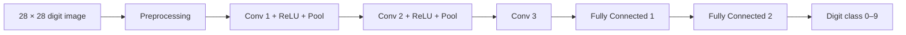

<div align="center">

# FPGA-Based CNN for Handwritten Digit Recognition

**A LeNet-inspired CNN accelerator implemented in Verilog for the Xilinx Zynq-7000 ZedBoard.**

[](https://en.wikipedia.org/wiki/Verilog)
[](https://www.amd.com/)
[](http://yann.lecun.com/exdb/mnist/)
[](https://www.amd.com/en/products/software/adaptive-socs-and-fpgas/vivado.html)

</div>

---

## Overview

This project explores handwritten digit recognition using a convolutional neural network (CNN) mapped to FPGA programmable logic. The software workflow uses Python and the MNIST dataset; the hardware design is written in Verilog and targets a Zynq-7000 ZedBoard.

The repository contains the RTL accelerator, a Python drawing utility, simulation assets, trained weight files, and a Vivado project. The report describes a host-to-board UART workflow, but the complete UART inference path is not yet verified in the checked-in source. See **[Implementation status](#implementation-status)** before attempting a live hardware demonstration.

## At a glance

| Area | Project details |
|---|---|
| Task | Handwritten digit classification (0–9) |
| Dataset | MNIST, 28 × 28 grayscale images |
| Model | LeNet-inspired, five-stage CNN pipeline |
| Hardware | Xilinx Zynq-7000 ZedBoard |
| RTL | Verilog |
| Arithmetic | Signed INT8 weights and activations |
| Host utility | Python / Tkinter |
| FPGA tools | AMD Xilinx Vivado |

## Architecture

The reported hardware pipeline consists of three convolution stages and two fully connected stages.



### FPGA datapath

The project report describes these implementation choices:

- **Eight parallel processing elements (PEs)** for concurrent computation.
- **5 × 5 convolution kernels**, with each PE described as performing a 25-term multiply-accumulate operation.
- A **47-state finite-state machine (FSM)** to sequence CNN operations.
- **INT8 fixed-point arithmetic** with wider accumulation and requantization.
- Parameterized on-chip BRAM for weights, input data, and intermediate feature maps.
- A reported **50 MHz** fabric clock target.

These are report-derived design details, not independently measured results in this repository. Confirm them against the current RTL and Vivado reports before citing them as achieved hardware metrics.

## Repository layout

The source tree is arranged by responsibility so the main project files are easy to find:

```text
.
├── rtl/                 # Verilog accelerator and hardware modules
├── software/            # Python drawing and helper utilities
├── tb/                  # Verilog testbench
├── test_inputs/         # Sample input, bitstream and validation utility
├── weights/             # Quantized layer weights (.hex)
├── vivado/              # Vivado project, block design and constraints
│   ├── LeNet_Accelerator.xpr
│   ├── LeNet_Accelerator.srcs/
│   ├── LeNet_Accelerator.ip_user_files/
│   └── scripts/         # Project restoration Tcl scripts
├── requirements.txt
├── .gitignore
└── README.md
```

Vivado-generated caches, run directories, logs, and the local Python virtual environment are intentionally excluded. Vivado can regenerate its build outputs.

## Getting started

### 1. Clone the repository

```bash
git clone https://github.com/hari1247/FPGA-BASED-CNN-FOR-DIGIT-RECOGNITION.git
cd FPGA-BASED-CNN-FOR-DIGIT-RECOGNITION
```

### 2. Set up Python

```bash
python -m venv .venv
```

Activate the environment:

```bash
# macOS / Linux
source .venv/bin/activate

# Windows PowerShell
.venv\Scripts\Activate.ps1
```

Install the packages listed in `requirements.txt`:

```bash
python -m pip install --upgrade pip
pip install -r requirements.txt
```

Run the drawing utility:

```bash
python software/main1.py
```

Tkinter may need to be installed separately on some Linux distributions. The Python utility and simulation input-file workflow should not be mistaken for a verified live UART transfer to the FPGA.

### 3. Open the Vivado project

1. Launch a compatible AMD Xilinx Vivado version (the project metadata identifies **2025.2**).
2. Open `vivado/LeNet_Accelerator.xpr`.
3. Confirm the target part and board are set for the Zynq-7000 ZedBoard.
4. Allow Vivado to regenerate missing IP output products and generated directories.
5. Review the source sets, block design, constraints, and simulation paths before running implementation.

The project targets device part `xc7z020clg484-1`. Board and timing settings should be verified against the physical board and current constraints.

### 4. Run the RTL simulation

The testbench is located at `tb/cnn_tb.v`. Before simulation:

- Confirm the testbench is selected as the simulation top.
- Check that all layer weight files in `weights/` are available to the simulator.
- Confirm the expected input image file is `test_inputs/in_32.hex`.
- Check the simulation working directory and any file paths used by `$readmemh`.

The expected layer weight files are:

- `out_conv1_32.hex`
- `out_conv2_32.hex`
- `out_conv3_32.hex`
- `out_fc1_32.hex`
- `out_fc2_32.hex`

## Reported results and known issues

The project report states that the software model achieved approximately **98% accuracy** on its evaluation workflow. This is a report-reported software result and must not be presented as measured FPGA accuracy.

The report also records hardware-side issues that need validation and correction:

| Case | Issue described in the report |
|---|---|
| Digits 1–8 | Variable hardware accuracy, attributed partly to quantization and preprocessing differences |
| Digit 0 | A polling condition can mistake a valid zero prediction for “not ready” |
| Digit 9 | A final-class boundary condition can omit class index 9 from the max-finder |

Do not describe all ten hardware classes as reliably working until the complete board-level test has been repeated.

## Implementation status

- **RTL and simulation assets:** present in the repository.
- **Vivado project:** included; generated build products are intentionally not versioned.
- **Python drawing utility:** included.
- **UART host-to-FPGA inference:** described in the report, but not yet established as a complete, reproducible path by the checked-in host and RTL sources.
- **Hardware performance:** requires fresh synthesis, implementation, timing, and board-level measurements.

The project restoration Tcl files are retained under `vivado/scripts/`. They were generated on another machine and may contain machine-specific source paths; review or regenerate those paths before using the scripts on a different computer.

## Suggested next steps

1. Complete and verify the host-to-FPGA data-transfer path.
2. Fix and regression-test the digit-0 completion handling and digit-9 class selection.
3. Match Python preprocessing, signedness, scaling, and rounding to the RTL datapath.
4. Add repeatable Python-versus-RTL test vectors for all ten classes.
5. Publish measured FPGA resource utilization, timing, latency, power, and hardware accuracy.

## License

No license is currently specified. Add a license before inviting reuse or redistribution.
